# Raycast Extensions

[](https://github.com/Delido/raycast-extensions/actions/workflows/ci.yml)
[](LICENSE)


Selbst gebaute [Raycast](https://www.raycast.com)-Extensions für IT-Admin-Alltag, Homelab, Game-Server und Gaming-PC. Jede Extension ist eigenständig, du installierst nur die, die du brauchst.

## Extensions

| | Extension | Wofür | Plattform |
|---|---|---|---|
| 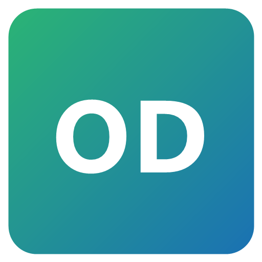 | **[OneDev](onedev/)** | Projekte, Issues, Pull Requests und Builds durchsuchen | Windows, macOS |
| 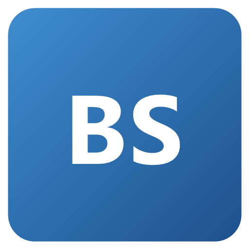 | **[BookStack](bookstack/)** | Wiki durchsuchen, Bücher und Seiten lesen | Windows, macOS |
| 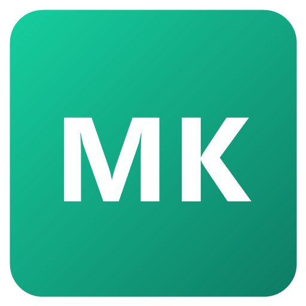 | **[Checkmk](checkmk/)** | Hosts und Services suchen, Probleme bestätigen, Benachrichtigung bei neuen Problemen | Windows, macOS |
| 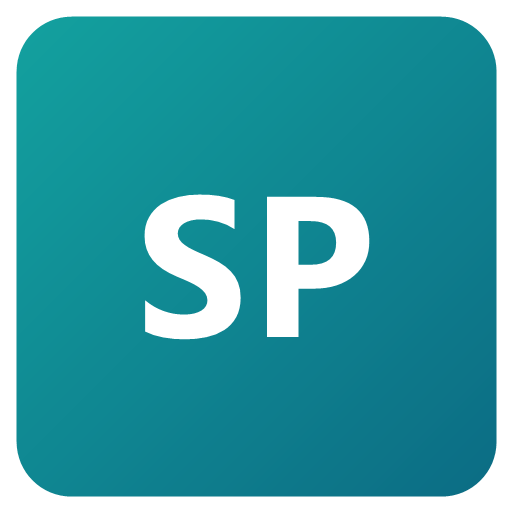 | **[SharePoint](sharepoint/)** | SharePoint-Seiten und Dokumente durchsuchen | Windows, macOS |
| 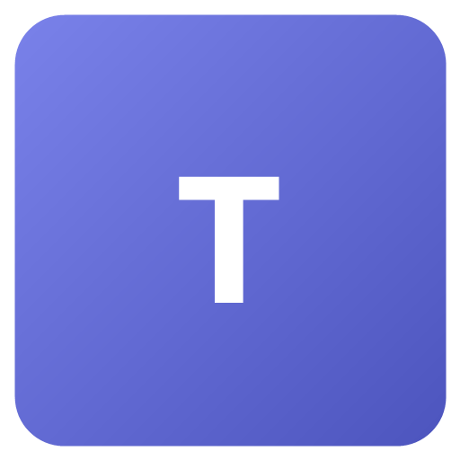 | **[Microsoft Teams](teams/)** | Personen, Chats, Kanäle, Nachrichten, Status, Meetings | Windows, macOS |
|  | **[Snipe-IT](snipeit/)** | Assets, Benutzer, Lizenzen und Zubehör suchen, Assets aus- und einchecken, Inventur und fällige Audits | Windows, macOS |
| 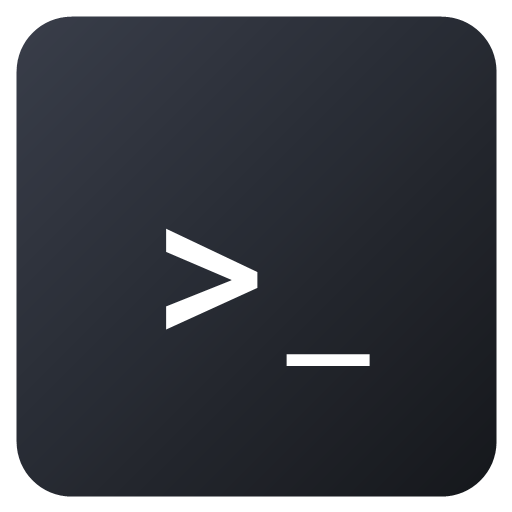 | **[SSH Sessions](ssh/)** | SSH-Hosts finden und verbinden, zentrale Host-Listen, SOCKS-Tunnel mit Browser, SFTP-Dateibrowser | Windows, macOS |
| 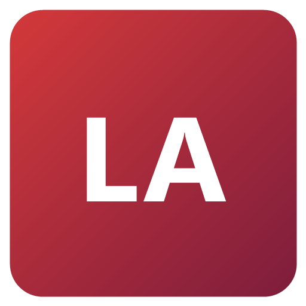 | **[LAPS Connect](laps-connect/)** | Für Admins: WireGuard-IP eines Rechners finden, Windows-LAPS-Passwort aus Entra holen, per SSH oder RDP verbinden, mit Passwortsperre | Windows, macOS |
|  | **[Keep Awake](keep-awake/)** | Rechner wach halten, optional Teams-Status auf Verfügbar | Windows, macOS |
|  | **[Paperless-ngx](paperless/)** | Dokumente suchen, bearbeiten, herunterladen und hochladen, mit Passwortsperre | Windows, macOS |
| 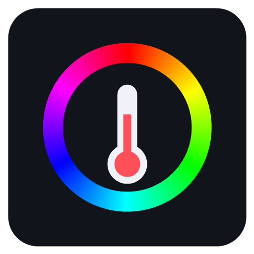 | **[SignalRGB](signalrgb/)** | PC-Sensoren live, Beleuchtung, Headset-Mute und -Akku, Tastatur-Game-Mode, CS2-Integration, Audioausgabe | Windows |
| 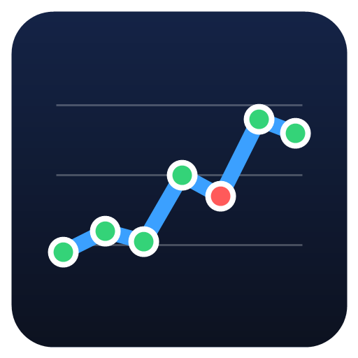 | **[MTR](mtr/)** | Traceroute wie WinMTR mit Graphen, Überwachung im Hintergrund, Alarme, HTML-Bericht | Windows |
| 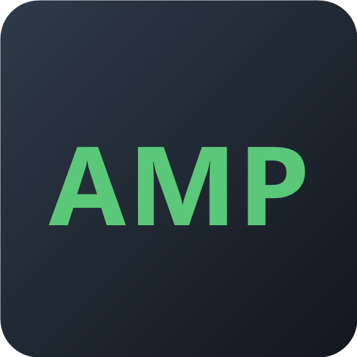 | **[AMP](amp/)** | CubeCoders-AMP-Game-Server steuern: Start/Stop, Konsole, Spieler, Backups, neue Server | Windows, macOS |
| 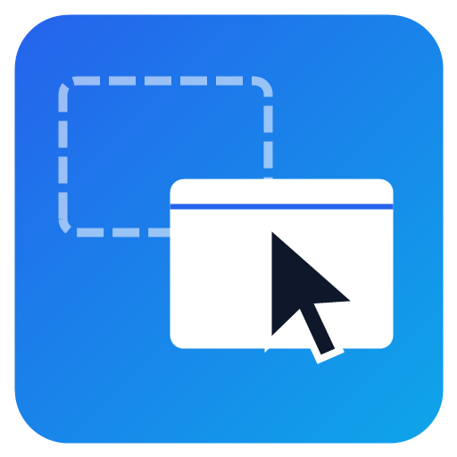 | **[Window Drag](window-drag/)** | Fenster mit Alt + Maus ziehen verschieben und in der Größe ändern, wie AltSnap | Windows |
| 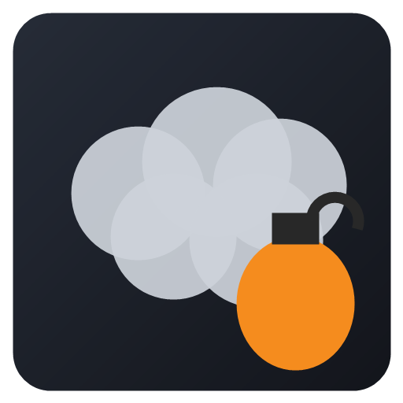 | **[CS2 Nades](cs2-nades/)** | Smoke-, Molotov-, Flash- und HE-Lineups der Premier-Maps, Video direkt in Raycast (per ffmpeg), live von [csnades.gg](https://csnades.gg) | Windows, macOS |
| 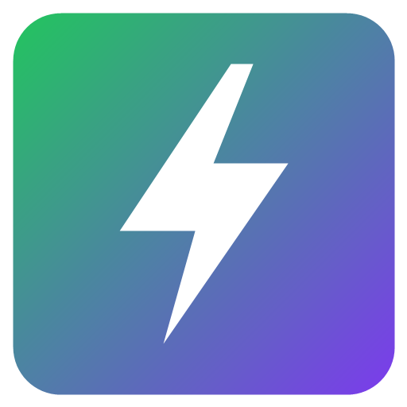 | **[Power Plan](power-plan/)** | Energiesparplan wechseln, automatisch Höchstleistung beim Spielen | Windows |
|  | **[GPT4Free](g4f/)** | KI-Chat und Textbefehle mit eigenen OpenAI-kompatiblen APIs (z. B. Open WebUI). Angepasste Kopie von [raycast-g4f](https://github.com/XInTheDark/raycast-g4f), GPL-3.0 | Windows, macOS |

Was jede Extension genau kann und wie sie eingerichtet wird, steht in ihrer eigenen README.

## Installation

Voraussetzungen: [Raycast](https://www.raycast.com) für Windows oder macOS, [Node.js](https://nodejs.org) 22 oder neuer und Git.

```sh
git clone https://github.com/Delido/raycast-extensions.git
cd raycast-extensions/<extension>     # z. B. paperless
npm install
npm run dev
```

`npm run dev` baut die Extension und meldet sie in Raycast an. Sobald im Terminal `ready - built extension successfully` steht, beendest du den Befehl mit **Ctrl+C**. Die Extension bleibt in Raycast installiert. Für jede weitere Extension wiederholst du das im jeweiligen Ordner.

Beim ersten Öffnen eines Befehls fragt Raycast nach den Einstellungen (Server-URL, Token usw.). Ändern kannst du sie später unter **Settings → Extensions → \<Extension\>**.

### Windows-Helfer (SignalRGB, MTR, Power Plan, Window Drag)

Diese Extensions bringen einen kleinen Helfer in Go mit, weil Node.js an die nötigen Windows-Schnittstellen nicht herankommt (ICMP mit TTL, Energiesparpläne, HID-Geräte, Core Audio, globaler Maus-Hook). Keiner davon braucht Administratorrechte.

- **Mit Go 1.26+** (`winget install GoLang.Go`) baut `npm run dev` den Helfer automatisch.
- **Ohne Go**: die passende `.exe` aus den [Releases](https://github.com/Delido/raycast-extensions/releases) in den Ordner `assets/` der Extension legen, dann `npm run dev`.

### Aktualisieren

```sh
git pull
cd <extension>
npm install
npm run dev     # nach "ready" mit Ctrl+C beenden
```

## Sicherheit

- Zugangsdaten (Tokens, Passwörter) liegen nur in Raycast, als Passwortfelder im verschlüsselten Raycast-Speicher, nie im Code oder im Repo.
- **Paperless-ngx** und **LAPS Connect** speichern ihre Zugangsdaten zusätzlich mit einem eigenen Passwort verschlüsselt und sperren sich nach einer einstellbaren Zeit.
- SharePoint, Teams und LAPS Connect melden sich per OAuth mit deinem eigenen Microsoft-Konto an. Sie sehen nur, worauf du ohnehin Zugriff hast.
- Die Windows-Helfer lauschen nur auf `127.0.0.1`.

## Tastenkürzel

Die Kürzel sind plattformabhängig: **Ctrl** unter Windows, **Cmd** auf dem Mac. Das Aktionsmenü öffnest du mit **Ctrl+K** bzw. **Cmd+K**. Eigene Hotkeys für einzelne Befehle legst du in Raycast unter **Settings → Extensions** fest.

Jeder Befehl lässt sich auch per Deeplink starten, zum Beispiel aus Makros oder Skripten:

```text
raycast://extensions/mendyka/<extension>/<befehl>
```

## Entwicklung

- Jede Extension ist ein eigenständiges Node-Projekt (React + TypeScript, [Raycast API](https://developers.raycast.com)).
- `npm run dev` startet den Entwicklungsmodus mit Live-Reload. `console.log` erscheint im Terminal.
- `npm run lint` prüft Code und Manifest. Die Meldung `Invalid author` kannst du ignorieren, das Feld `author` muss nur für den öffentlichen Raycast Store ein gültiger Store-Benutzername sein.
- `npm run build` erzeugt einen Produktions-Build.
- Die [CI](.github/workflows/ci.yml) baut, typprüft und lintet bei jedem Push alle Extensions und Helfer. Ein Tag `v*` erzeugt über den [Release-Workflow](.github/workflows/release.yml) ein Release mit den fertig gebauten Helfern.

Weitere Dokumentation in [docs/](docs/):

- [Microsoft-App-Registrierung](docs/microsoft-app-registration.md) für SharePoint und Teams
- [Einrichtung von LAPS Connect](docs/laps-connect-setup.md): Entra-App und UniFi-API-Key
- [SignalRGB-Schnittstellen](docs/signalrgb-schnittstellen.md): lokale REST-API, WebPipe (QWebChannel) und Mobile Remote

## Lizenz

[MIT](LICENSE), mit einer Ausnahme: [g4f/](g4f/) ist eine angepasste Kopie von [raycast-g4f](https://github.com/XInTheDark/raycast-g4f) und steht wie das Original unter der [GPL-3.0](g4f/LICENSE.txt).
